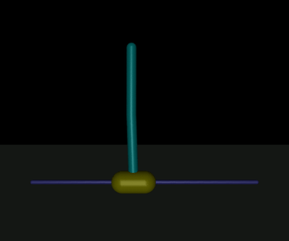

# CS 7641 — Machine Learning (Georgia Tech OMSCS)

My write-ups for **CS 7641 Machine Learning**, taken in **Spring 2025** as part of Georgia Tech's Online Master of Science in Computer Science (OMSCS).

**Final grade: A**

  

From Assignment 4: a deep-RL agent (Soft Actor-Critic) balancing a double inverted pendulum and recovering after being pushed.

---

## About the course

CS 7641 is the graduate machine learning course of the OMSCS program. The lectures are by Charles Isbell and Michael Littman, and they cover the three main areas of the field:

| Block | Topics |
|---|---|
| **Supervised Learning** | Decision trees · regression and classification · neural networks · instance-based learning (kNN) · ensembles and boosting · kernel methods and SVMs · computational learning theory · VC dimension · Bayesian learning and Bayesian inference |
| **Unsupervised Learning** | Randomized optimization (hill climbing, simulated annealing, genetic algorithms, MIMIC) · clustering (k-means, EM) · feature selection · feature transformation (PCA, ICA, random projections) · information theory |
| **Reinforcement Learning** | Markov decision processes · value and policy iteration · model-free RL (Q-learning and related methods) · game theory |

The assignments are what sets the course apart. Students do not implement algorithms. Each assignment is an **empirical study**: you frame an ML problem, state a hypothesis, design experiments with standard libraries, tune and compare algorithms, and defend your conclusions in a report of at most 8 pages, written in the style of a conference paper. The grade depends on the quality of the analysis, meaning *why* the algorithms behave as they do on the data, and not on the code.

## Assignments

| # | Assignment | Course block | Methods | What it's about |
|---|---|---|---|---|
| 1 | [**Supervised Learning**](assignments/A1-supervised-learning.md) | Supervised Learning | kNN · SVM · neural networks | Two imbalanced classification problems (marketing response, hit songs). Learning and model-complexity curves, and how the curse of dimensionality affects distance-based learners |
| 2 | [**Randomized Optimization**](assignments/A2-randomized-optimization.md) | Unsupervised Learning | RHC · SA · GA · gradient descent | Deceptive vs. smooth fitness landscapes (Four Peaks, One Max), then training a neural network's weights without gradients |
| 3 | [**Unsupervised Learning**](assignments/A3-unsupervised-learning.md) | Unsupervised Learning | K-Means · EM/GMM · PCA · ICA · RP · Isomap | Clustering and dimensionality reduction as preprocessing, and whether they help a downstream neural network |
| 4 | [**Reinforcement Learning**](assignments/A4-reinforcement-learning.md) | Reinforcement Learning | VI · PI · SARSA · Q-Learning · SAC | Model-based vs. model-free RL on Blackjack and a discretized CartPole, plus deep RL on a MuJoCo double pendulum |

### Themes across the assignments

- **Hypothesis-driven experiments.** Every study starts from a falsifiable expectation. Several of mine turned out wrong, for example that dimensionality reduction would help the classifier, or that finer CartPole grids would help dynamic programming. Explaining *why* they were wrong was often the most useful part.
- **Choosing the right metric.** Both datasets are imbalanced, so F1 and PR-AUC matter more than accuracy. Clustering was judged with silhouette, BIC and inertia, and RL agents with reward curves and the rewards of the final policies.
- **Bias/variance in practice.** Learning curves, validation curves, restarts and population sizes, exploration decay: in every assignment the question is how much capacity or exploration a method needs and what it costs.
- **Reproducibility.** The experiments use fixed random seeds, repeated runs averaged together, and pinned environments. Each assignment had to be reproducible by the TAs on a standard Linux machine.

## Tools

Python · scikit-learn · pandas · NumPy · SciPy · matplotlib / seaborn · ydata-profiling · mlrose-hiive · Gymnasium · bettermdptools · Stable-Baselines3 (PyTorch) · MuJoCo · Jupyter · LaTeX (Overleaf)

## About this repository

This repository is a **portfolio summary**, not a copy of my coursework. In line with Georgia Tech's academic honor code, it does **not** contain source code, the submitted reports or any course material. What is here:

- **New write-ups** describing each problem, my hypotheses, the approach and the main qualitative findings.
- **A selection of figures** from my own experiments, plus diagrams and illustrations made for these pages.
- **Figures regenerated for this page**: the Blackjack policy re-drawn with readable axes, and an animation made by running one of the RL agents locally again.

If you are currently taking CS 7641, please do your own analysis. The course is designed so that the learning comes from doing it yourself.
