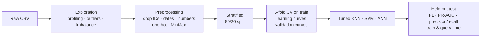
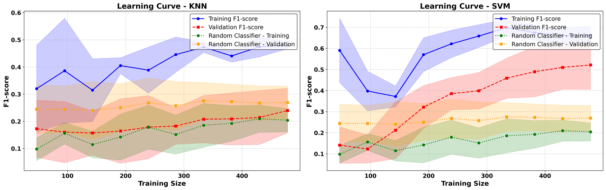
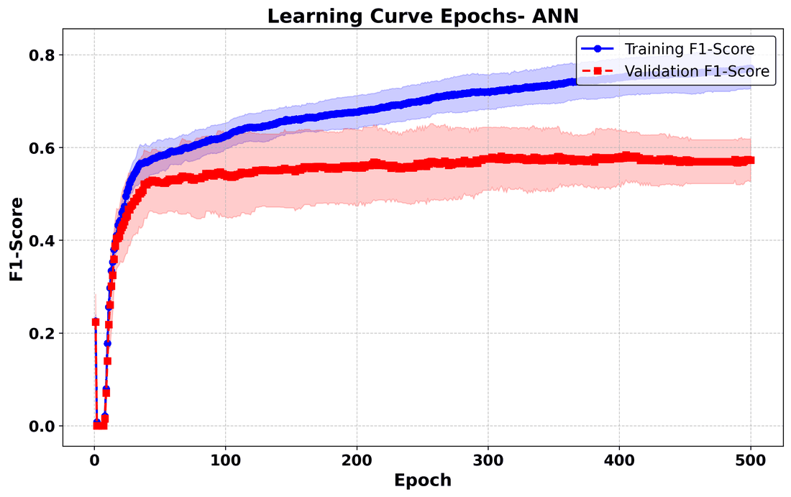
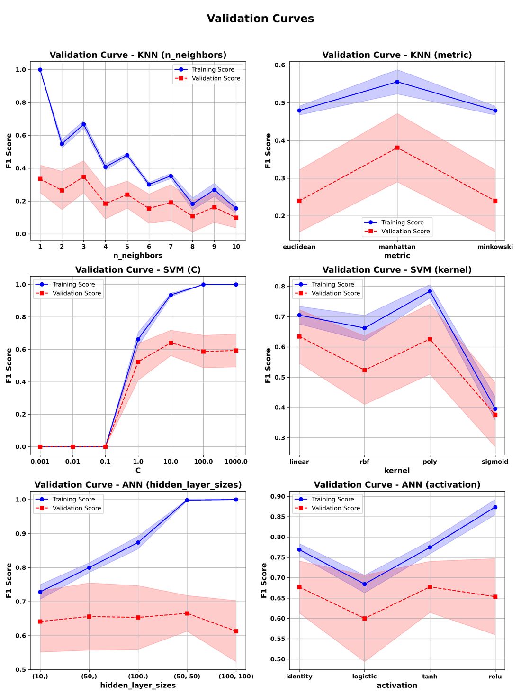

# Assignment 1 — Supervised Learning

**Course block:** Supervised Learning · **Algorithms:** k-Nearest Neighbors, Support Vector Machines, Neural Networks
**Tools:** Python, scikit-learn, pandas, ydata-profiling, matplotlib/seaborn

[← Back to overview](../README.md)

## The problem

The assignment gave every student the same two datasets and asked for two non-trivial classification problems. I chose these two:

| Task | Dataset | Target | Positive class |
|---|---|---|---|
| **Marketing response** | [Customer Personality Analysis](https://www.kaggle.com/datasets/imakash3011/customer-personality-analysis) (≈2.2k customers, demographic + purchasing history) | Did the customer accept the last campaign? | ~15% |
| **Hit song prediction** | [Most Streamed Spotify Songs 2023](https://www.kaggle.com/datasets/nelgiriyewithana/top-spotify-songs-2023) (≈950 tracks, audio features + playlist/chart presence) | Is the track in the top 25% by streams? (label I defined) | 25% |

Both problems are **imbalanced**, mix numerical and categorical attributes, and have many features relative to the number of samples.

**Hypothesis.** KNN classifies by distance to its neighbours. With many weakly relevant features, those distances carry less and less information (the *curse of dimensionality*). I therefore expected **SVM and ANN to clearly outperform KNN**: SVM thanks to margin maximization and kernels, ANN thanks to the internal features it learns.

## Pipeline

**F1** was the main metric throughout, because on imbalanced data accuracy is misleading: always predicting "no" already scores 75–85%. Every learning curve also shows a **random classifier** as a baseline to beat.

## 1. Learning curves: how much does more data help?

  

Hit-song task, F1 vs. training-set size (5-fold CV, shaded area = ±1 std).

- **KNN (left):** a wide gap between training and validation, and validation F1 hardly rises above the random baseline even as data grows. The model overfits, and the problem is the geometry of the feature space, not the amount of data.
- **SVM (right):** validation F1 rises steadily with data and pulls well away from the baseline, so it generalizes much better.
- **ANN:** similar to SVM, with a smaller train/validation gap than KNN. Its validation score levels off after a few hundred epochs (below), so training longer only widens the gap.

  

Marketing task, ANN F1 vs. epochs. Validation F1 levels off while training F1 keeps rising, so the extra epochs only overfit.

## 2. Validation curves: tuning each model's capacity

  

Hit-song task. Rows: KNN (k, distance metric), SVM (C, kernel), ANN (hidden layers, activation).

| Model | Hyperparameters explored | What the curves show |
|---|---|---|
| **KNN** | *k* · distance metric | Small *k* fits the training set but widens the gap to validation (high variance). **Manhattan** distance clearly helps on the Spotify data, and on the marketing data all metrics perform about the same. |
| **SVM** | *C* · kernel | Very small *C* underfits completely. A moderate *C* gives the best balance, and larger values only raise the training score. **Linear** and polynomial kernels generalize best, while sigmoid is poor. |
| **ANN** | hidden layers · activation | Deeper networks push training F1 towards 1 without improving validation. A **small network** is enough. The activation function matters less, with ReLU overfitting the most. |

## 3. Final comparison on the held-out test set

- **The hypothesis held on both datasets.** SVM and ANN beat KNN on F1 and PR-AUC.
- **ANN had the highest recall on both tasks.** It catches more of the rare positives. On the marketing task this cost it some precision compared with SVM, which was the more conservative classifier.
- **The three models cost very different amounts to train and to query:**

| | Training time | Query time |
|---|---|---|
| KNN | none (it just stores the data) | **slowest**, since it compares against the whole training set |
| SVM | moderate | fast |
| ANN | moderate to highest (highest on the Spotify task) | fastest |

**Next steps I proposed:** feature weighting for KNN, scaling that is robust to outliers, and dimensionality reduction before the distance-based learner. The last one became part of [Assignment 3](A3-unsupervised-learning.md).
