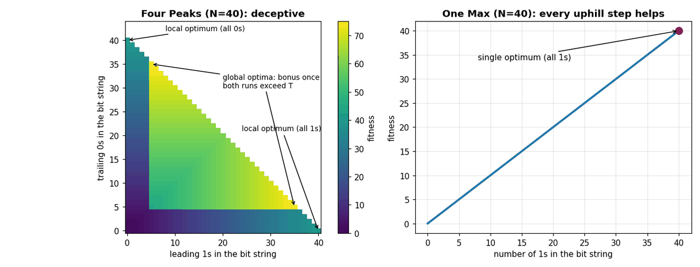
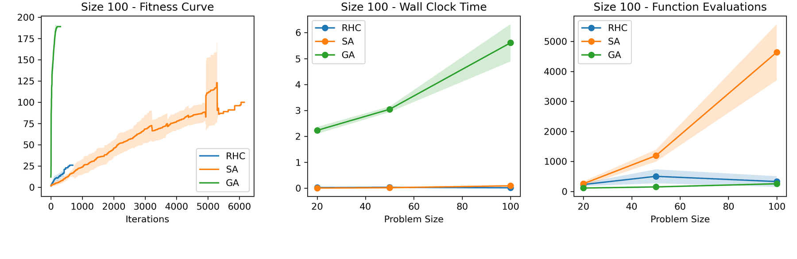
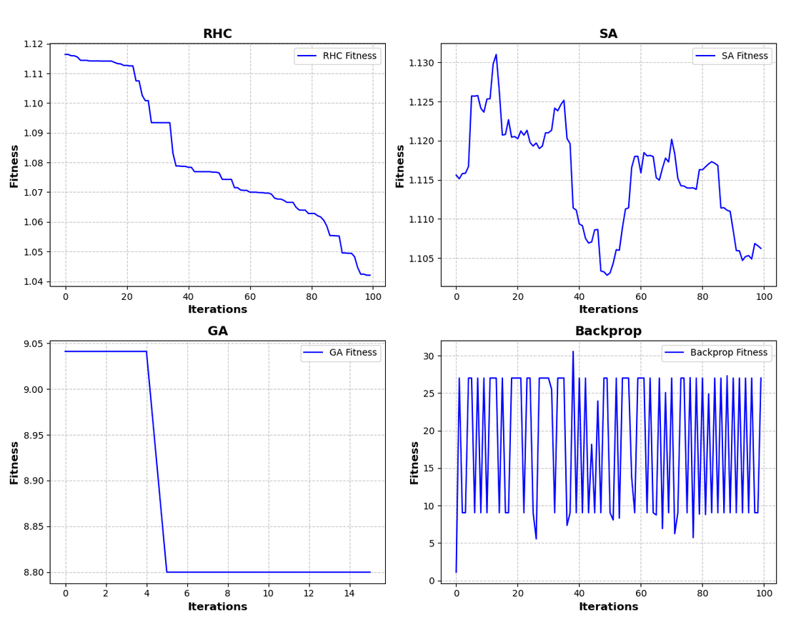
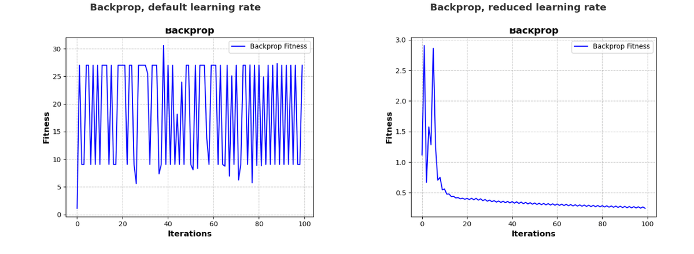

# Assignment 2 — Randomized Optimization

**Course block:** Unsupervised Learning (Randomized Optimization) · **Algorithms:** Randomized Hill Climbing (RHC), Simulated Annealing (SA), Genetic Algorithm (GA), plus gradient descent as a baseline
**Tools:** Python, mlrose-hiive, scikit-learn, pandas, matplotlib

[← Back to overview](../README.md)

## The three optimizers

| | How it searches | How it escapes a local optimum | Main knobs I tuned |
|---|---|---|---|
| **RHC** | Moves to a random neighbour only if the neighbour is better | It cannot, except by **restarting** from a new random point | restarts, patience (`max_attempts`) |
| **SA** | Like RHC, but also accepts *worse* moves, with a probability controlled by a "temperature" that decreases over time | Early on, the high temperature lets it accept downhill moves | cooling-schedule decay, patience |
| **GA** | Evolves a *population* through selection, crossover and mutation | Its diverse population searches many regions in parallel | population size, mutation probability, patience |

## Part 1 — Two bit-string problems with very different landscapes

  

Illustration drawn from the two fitness functions. <b>Four Peaks</b> rewards the longer of two runs (leading 1s or trailing 0s) and adds a large bonus only when <i>both</i> runs exceed a threshold <i>T</i>. The two obvious peaks, all 1s and all 0s, are traps. <b>One Max</b> just counts the 1s, so every uphill step leads to the single optimum.

**Hypothesis.** RHC's greedy moves should trap it on Four Peaks while keeping it competitive on One Max. SA and GA should cope with the deceptive landscape.

**Setup.** Three problem sizes, **10 random seeds** per configuration. For each run I recorded fitness against iterations, wall-clock time and number of fitness evaluations. I ran the library defaults first, then tuned the knobs listed above.

  

Four Peaks. <b>Left:</b> fitness at the largest size. GA reaches the optimum within a few generations, SA keeps climbing slowly, and RHC stalls early. <b>Middle, right:</b> cost against problem size. GA is by far the slowest in wall-clock time, and SA uses the most fitness evaluations.

**Results**
- **The hypothesis held.** On One Max, all three algorithms converge to the optimum. On Four Peaks, RHC gets stuck, and its time and evaluation counts even *fall* as the problem grows, because it gets trapped sooner.
- **Tuning helped each algorithm in a different way:**

| | What helped | Trade-off |
|---|---|---|
| RHC | **More restarts** gave consistently better final fitness. More patience helped only on the largest Four Peaks instance. | Each restart costs more time. |
| SA | Slower cooling means longer exploration. | Convergence takes longer. |
| GA | A **larger population** helped more and more as the problem grew. | Too much mutation broke up good partial solutions on large problems. |

- **Overall ranking:** GA found the best solutions, and its lead over SA widened with problem size, but each iteration cost the most. SA did solidly at every size, but fell further behind GA as the problems grew. RHC stayed behind on the deceptive problem even after tuning.

## Part 2 — Training a neural network without gradients

The same optimizers replace backpropagation to set the **weights of a fixed neural network**, which classifies hit songs on the Spotify dataset from [Assignment 1](A1-supervised-learning.md).

**Hypothesis.** The randomized methods should need far more iterations than gradient descent. The weight space is continuous and irregular, the methods were designed for discrete spaces, and the network architecture had been tuned for gradient descent.

  

Training loss with default settings. RHC decreases slowly but steadily. SA wanders, because it accepts worse solutions on purpose. GA stalls almost immediately. Backprop oscillates wildly.

  

The oscillation came from a learning rate that was too large. Reducing it made backprop converge smoothly. The randomized methods were much less sensitive to the learning rate.

**Results**
- **Gradient descent was clearly best** on both predictive quality and training time once its learning rate was fixed.
- **RHC was the strongest randomized method, with SA close behind.** Raising the iteration limit alone did not help RHC and GA, which stalled early. **More patience** (`max_attempts`) was what let them keep improving.
- **GA struggled the most.** Its default population was not diverse enough for such a large continuous search space.
- Once trained, all models had **similar query times**. The difference is entirely in training cost.
