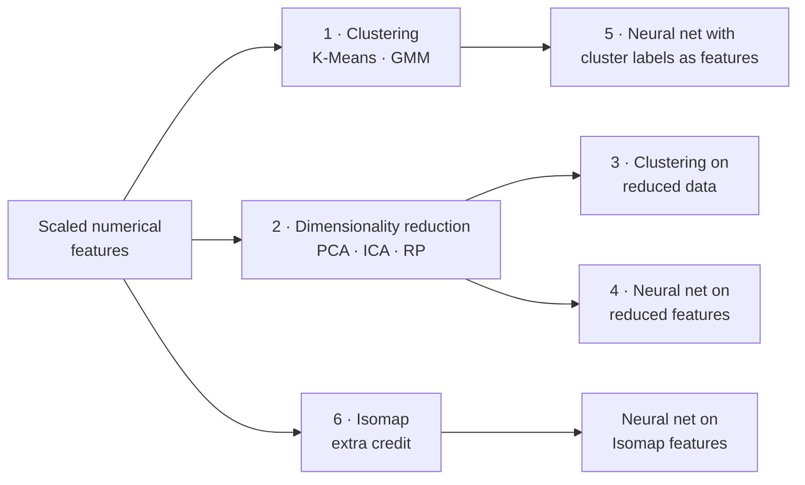
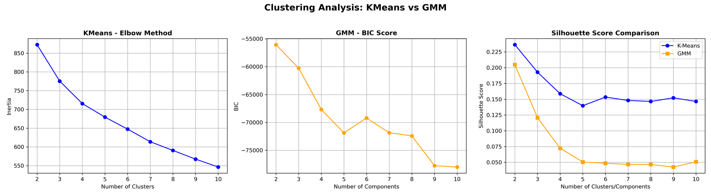
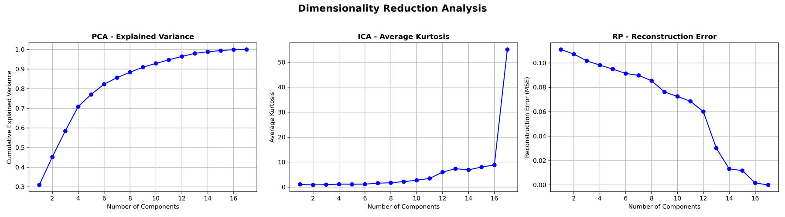
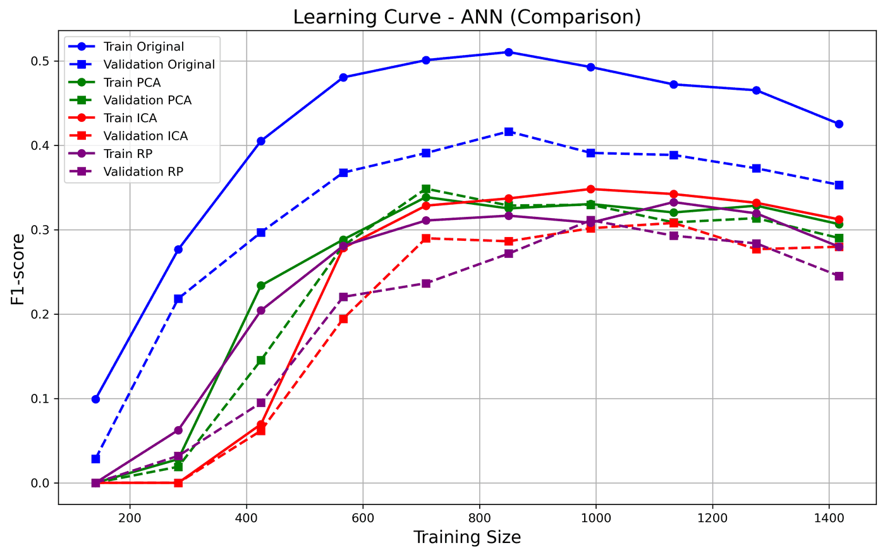
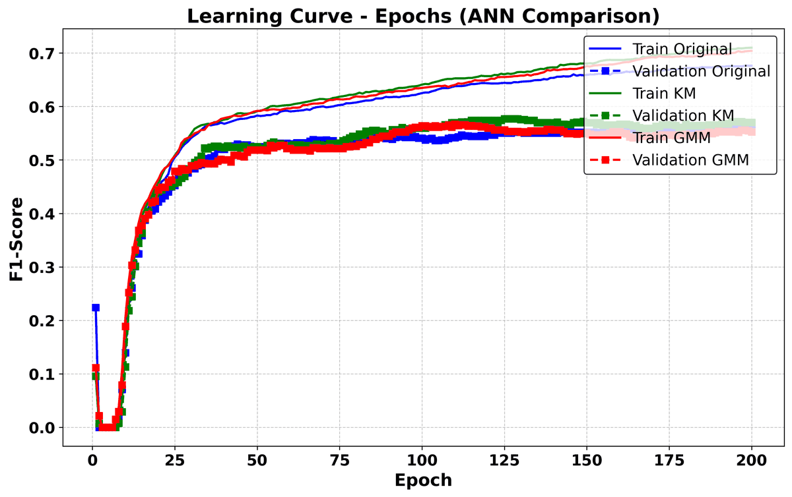

# Assignment 3 — Unsupervised Learning and Dimensionality Reduction

**Course block:** Unsupervised Learning · **Algorithms:** K-Means, Expectation-Maximization (Gaussian Mixture Models), PCA, ICA, Random Projection (RP), Isomap (extra credit)
**Tools:** Python, scikit-learn, SciPy, pandas, matplotlib/seaborn

[← Back to overview](../README.md)

## The question

Can structure found *without labels* help a supervised learner? I used the two datasets from [Assignment 1](A1-supervised-learning.md): customer marketing response, and Spotify hit songs.

**Hypotheses**
- Compressing correlated features should remove noise and help generalization.
- Cluster membership should act as a weak prior that speeds up learning.

## The algorithms and how I chose their size

| Method | What it looks for | How I chose *k* / number of components |
|---|---|---|
| **K-Means** | Compact, spherical groups (hard assignments) | Elbow of inertia, silhouette |
| **GMM (EM)** | Overlapping Gaussian groups (soft assignments) | BIC (penalizes complexity), silhouette |
| **PCA** | Orthogonal directions of maximum variance | Cumulative explained variance |
| **ICA** | Statistically independent, non-Gaussian sources | Average kurtosis of the components |
| **RP** | A random projection that approximately preserves distances | Reconstruction error |
| **Isomap** | A non-linear manifold (preserves geodesic distances) | Reconstruction error |

**One modelling decision that mattered.** On a first pass with every feature included, the binary one-hot columns dominated the Euclidean distances and created separation that wasn't really in the data. All clustering and projections were therefore run on the **scaled numerical features only**.

## 1. Clustering the original data

  

Marketing data. The inertia curve has no sharp elbow. BIC has a local minimum around 5 components. Silhouette scores are low for both methods, with K-Means consistently above GMM.

- The metrics broadly agreed on **4–5 clusters** for both datasets, but none of them showed a clear winner. **Neither dataset has strongly separated natural groups.**
- Silhouette uses hard labels and Euclidean distance, which partly favours K-Means over the soft-assignment GMM. Metrics designed for probabilistic models would give a fairer comparison.

## 2. Dimensionality reduction

  

Marketing data. PCA explains about 90% of the variance with roughly half of the features. ICA's kurtosis stays flat and then spikes at the high end, a sign of a few very non-Gaussian sources. RP reconstruction error drops sharply once enough dimensions are kept.

- **Both datasets are highly redundant.** Spending categories and playlist counts are strongly correlated, so PCA compresses them well.
- **RP is surprisingly good for how cheap it is.** It kept distances well enough to give some of the best cluster separation after reduction.
- **ICA's components gave the weakest clusters.** The structure in these datasets is better described by correlated combinations of features, which is what PCA captures, than by independent sources.
- Whether reduction improves clustering **depends on the dataset**. It helped clearly on one and only modestly on the other.

## 3. Does it help a neural network?

The downstream test was a fixed neural-network architecture trained on the marketing task with each representation, evaluated with learning curves, validation curves, test metrics and runtime.

  

F1 against training-set size. The original features (blue) stay above every compressed representation, on both training and validation.

- **Dimensionality reduction lowered the F1 during training and validation, against my hypothesis.** Compression discarded some information the task needed, and the reduced models also gained less from extra network capacity.
- **On the held-out test set, the gap nearly closed.** PCA and ICA came close to the original features, and every reduced model trained faster.

  

F1 against epochs with cluster labels appended as one-hot features. K-Means (green) and GMM (red) improve slightly faster early on, and all three end at about the same level.

- **Cluster features sped up early learning but did not improve the final result.** GMM features kept final performance level with the baseline, while K-Means was slightly worse. Deeper networks started to overfit to the extra features.
- **Isomap (extra credit) did not help.** The non-linear embedding gave the weakest classifier of all the reduced representations. A manifold only helps classification when it lines up with the class boundary.
