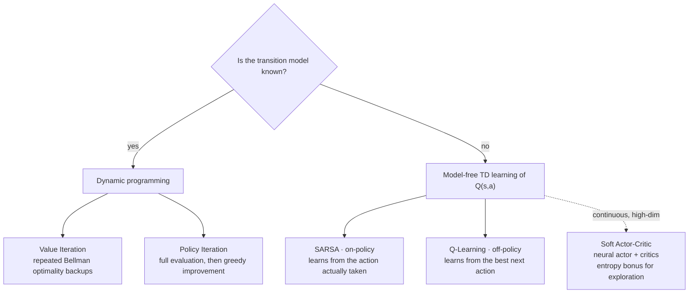
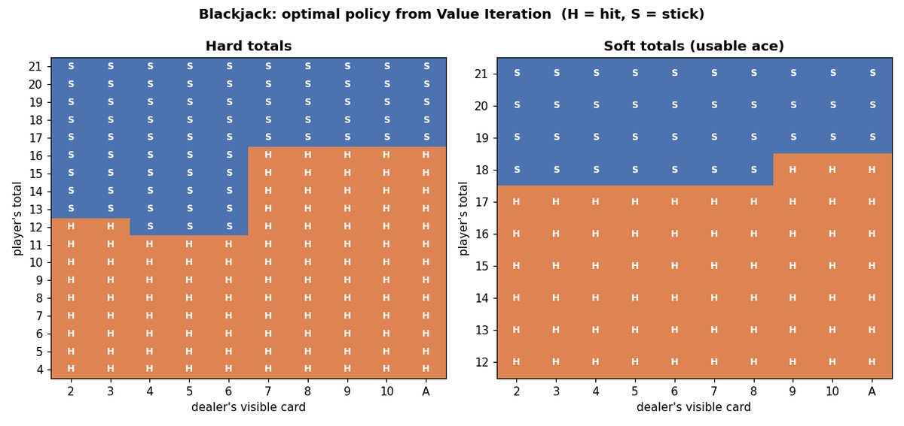
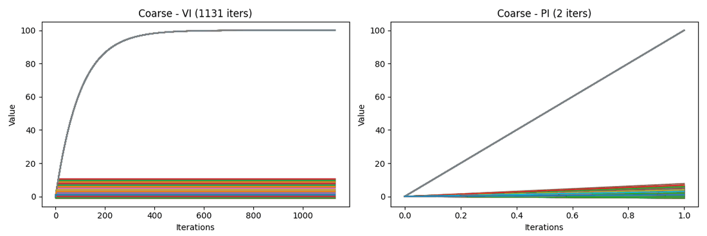
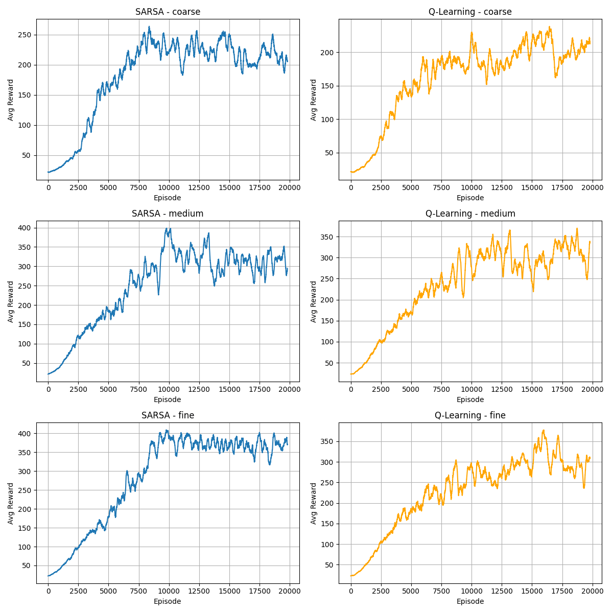
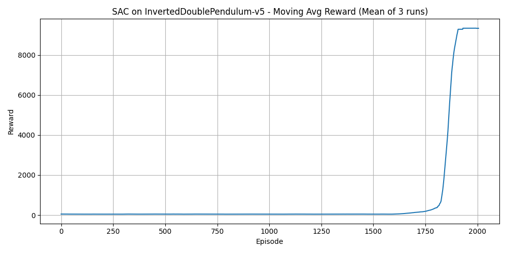
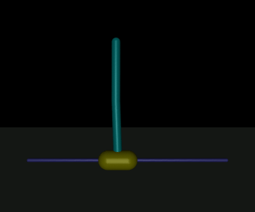

# Assignment 4 — Markov Decision Processes and Reinforcement Learning

**Course block:** Reinforcement Learning · **Algorithms:** Value Iteration (VI), Policy Iteration (PI), SARSA, Q-Learning, Soft Actor-Critic (SAC, extra credit)
**Tools:** Python, Gymnasium, bettermdptools, Stable-Baselines3 (PyTorch), MuJoCo, pandas, matplotlib

[← Back to overview](../README.md)

## The environments

| | **Blackjack** (`Blackjack-v1`) | **CartPole** (`CartPole-v1`) | **Double pendulum** (`InvertedDoublePendulum-v5`, extra credit) |
|---|---|---|---|
| State space | small, discrete (hand total × dealer card × usable ace) | continuous, 4 variables (cart position, velocity, pole angle, angular velocity) | continuous, high-dimensional |
| Dynamics | stochastic | deterministic | deterministic, highly unstable |
| Rewards | sparse: +1 / 0 / −1 at the end of the hand | +1 for every step the pole stays up | dense, but large only while the pendulum stays balanced |
| Methods used | VI, PI, SARSA, Q-Learning | same, on a **discretized** state space | SAC (deep RL) |

## The methods

**Hypotheses**
- VI and PI should excel on the small, fully known Blackjack model.
- On-policy SARSA should be steadier in the stochastic game. Greedy, off-policy Q-Learning should do better on deterministic CartPole.
- For CartPole, a finer discretization should give better policies, at the cost of more computation.

## 1. Model-based: Value and Policy Iteration

**Blackjack.** VI and PI converged to the **same value function and the same policy**. PI needed about half as many iterations, although each of its iterations costs more.

  

Optimal policy found by VI, re-drawn with labelled axes (same setup as in the assignment). It recovers familiar Blackjack strategy. On hard totals, stick from 17, and from 13 when the dealer shows a weak 2–6. With a usable ace, keep hitting up to soft 17, since the ace protects against busting.

**CartPole.** To make it usable for DP, the state space was discretized at three granularities (coarse, medium, fine), which grows the model from a few hundred to a few thousand states.

  

Each line is one state's value across iterations. VI (left) approaches the solution gradually over many sweeps, while PI (right) settles after a couple of evaluate-and-improve steps.

- The iteration counts stayed the same at every granularity, but the **runtime grew about tenfold** from coarse to fine.
- **Finer grids gave *worse* DP policies, against my hypothesis.** Planning over a larger, more fragmented model overfit to distinctions that don't help keep the pole up.

## 2. Model-free: SARSA and Q-Learning

Both used ε-greedy exploration with decaying ε and learning rate. I compared three decay speeds (slow, medium, fast) and, for CartPole, the three discretizations. Each configuration ran 20,000 episodes, repeated over several seeds, and the learned policies were then evaluated on separate test episodes.

  

Smoothed reward per episode on CartPole for SARSA (left) and Q-Learning (right), from coarse (top) to fine (bottom). SARSA's plateau rises and becomes steadier as the grid gets finer. Q-Learning's stays noisy.

| | Blackjack | CartPole |
|---|---|---|
| **vs. DP** | Needed far more interaction, then came close to the DP policy | **Much better than DP.** Finer grids *helped* here, as expected. |
| **SARSA vs Q-Learning** | SARSA slightly better and steadier, as expected. Q-Learning trained faster. | **SARSA won at fine resolution**, with higher reward and lower variance, against my hypothesis. Q-Learning's greedy updates likely amplified early estimation errors in the large state space. |
| **Exploration decay** | Small differences; slower decay was slightly better for SARSA | Fast decay gave the highest average reward, and medium decay the most stable runs |

## 3. Deep RL: Soft Actor-Critic on the double pendulum (extra credit)

A two-link pendulum on a cart has a continuous action space and is dynamically unstable, which puts it out of reach of tabular methods. SAC trains a neural actor and critics, and adds an entropy bonus to the reward so that the agent keeps exploring.

  

Moving-average reward (mean of 3 runs). The curve stays flat for a long time and then jumps once the agent discovers how to balance.

  

Rollout of a SAC agent trained with the same configuration and re-run locally for this page. The cart is pushed three times, and the agent recovers each time.

- SAC **solved the task with close to the maximum return**, but only after a long exploration phase. Training took far longer than any of the tabular experiments.
